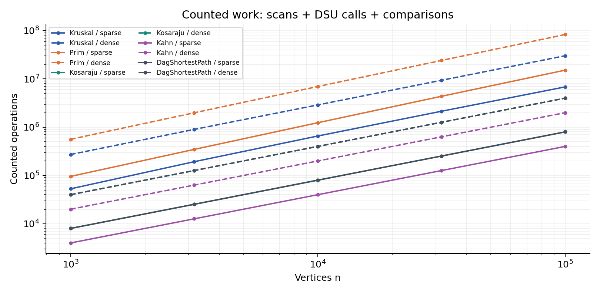
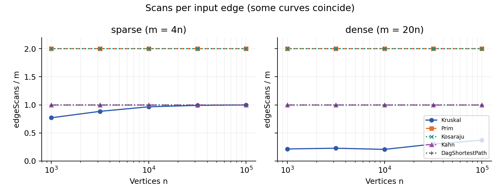
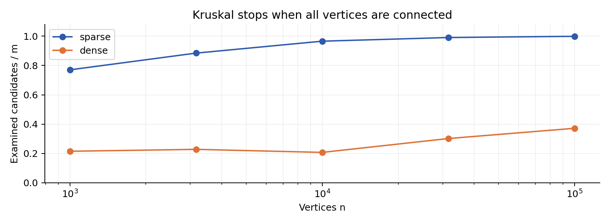

# Assignment 3 | Graph Algorithms

Begaliev Bakdaulet | SE-2526 | Design and Analysis of Algorithms

Repository: https://github.com/bakdauletbegaliev/graphs | Release: main / v1.0

## 1. Implementation and scope

The city network uses minimum spanning forests to connect districts at minimum cost. The scheduler uses SCCs to identify mutually dependent jobs, Kahn to order an acyclic job graph, and DAG shortest paths to find minimum-weight routes from all source jobs. One adjacency-list Graph supports directed and undirected input, loops, parallel edges and isolated vertices. All six mandatory algorithms are implemented; optional bonus tasks are outside this submission.

## Complexity of the actual implementations

| Algorithm | Time | Extra space | Reason |
| --- | --- | --- | --- |
| DSU find / union | Amortized O(alpha(V)) | O(V) structure; O(1) per operation | Union by size and path compression; makeSet is O(V). |
| Kruskal | O(V + E log(E+1)) | O(V+E) | Sort a copy of all edges; DSU rejects cycles. |
| Prim (lazy heap) | O(V + E log(E+1)) | O(V+E) | Each edge can enter the heap; stale entries are skipped. |
| Kosaraju | O(V+E) | O(V+E) | Two iterative DFS passes and a reversed graph. |
| Kahn | O(V+E) | O(V) | Copy stored in-degrees; scan each outgoing edge once. |
| DAG shortest paths | O(V+E) | O(V) | Topological sort followed by one relaxation pass. |

Space excludes the input graph but includes returned results. Lazy Prim stores edges rather than one key per vertex; hence log(E+1) is the accurate multigraph bound. For connected simple graphs this is commonly written O(E log V). The generator uses m=4n or m=20n, so both families are asymptotically sparse, despite the assignment naming the second family dense.

## Counter contract

dsuOps counts find calls plus successful unions, not parent-pointer steps. Kruskal counts examined sorted candidates; Prim counts both adjacency directions; Kosaraju counts DFS scans only (not reverse construction). In-degrees are maintained on insertion. DAG edgeScans counts relaxation only; its time also includes Kahn, measured with a separate counter object. comparisons counts sort/heap weight comparisons and DAG distance comparisons. maxDepth records peak explicit-stack occupancy.

The benchmark uses fresh Random(42) for every graph. For a self-pair it redraws b only; all 30 reference results are reproduced. Every CSV timing is the median of five runs. No timing or operation count is fabricated from a formula.

---

# 2. Correctness and validation

## Cut property: why both MST algorithms work

A cut divides the vertices into two sets. Let e be a minimum-weight edge crossing a cut that respects the edges already chosen. If a minimum spanning tree does not contain e, adding e creates a cycle. That cycle contains another crossing edge f, whose weight is at least the weight of e. Replacing f by e gives a spanning tree with no larger weight, so a minimum spanning tree containing e exists. Kruskal uses a cut around a DSU component when accepting the cheapest remaining edge between components. Prim uses the cut between its visited vertices and the rest of the current connected component. Repeating safe additions yields an MST in each connected component, hence a minimum spanning forest when the graph is disconnected.

## Topological induction: why one relaxation pass works

Initialize every zero-in-degree vertex with distance zero and all other vertices with infinity. This is equivalent to adding a virtual super-source with zero-weight edges to all sources. As a base case, a source already has its optimal distance before processing. Assume all vertices earlier than v in a topological order have their correct distances. Every incoming edge of v comes from such an earlier vertex, so all possible final steps into v have already been relaxed. The minimum of these candidates is therefore the correct distance for v, and relaxing its outgoing edges preserves the induction. Negative edges are safe because a DAG has no cycle; in a general graph an accessible negative cycle can make shortest distances unbounded, while negative edges alone do not always prevent finite answers. Saving the improving predecessor in parent reconstructs a real shortest path.

## SCC and topological invariants

The first Kosaraju pass records a vertex only after all outgoing DFS work finishes. In decreasing finish order on the reversed graph, each new search stays inside one unassigned SCC. Both passes use array stacks, so the JVM call stack does not grow with path length. Kahn removes only zero-in-degree vertices; if any vertices remain, they contain a cycle. A separate validator checks every edge against positions in the returned order.

## Executed JUnit 5 tests

| Test family | Independent evidence |
| --- | --- |
| DSU | 1,000 random unions checked against simple component labels. |
| MST | 100 random connected graphs; weights, n-1 edges and acyclicity. Also 30 tiny graphs checked against exhaustive subsets. |
| SCC | 40 random graphs (n <= 200) compared with mutual reachability from all-pairs BFS. |
| DAG paths | 100 random DAGs with negative weights checked against Bellman-Ford, plus path restoration. |
| Boundary tests | Four input files; empty/disconnected/isolated vertices; loops; parallel edges; cycles; long totals. |
| Stack and counters | 100,000-vertex path: depth 100,000, scans 199,998; exact 2m/m/m scan checks. |

All 10 JUnit methods passed. See results/tests.log and results/maven-build.log for execution evidence. Benchmark checks also run for every timed repetition: reference results, MST agreement, tree size, topological validity, scan invariants and repeatable counters.

---

# 3. Measured results and normalization

## Every assignment reference matched

| n | m | MST (both) | SCC count | DAG distance sum |
| --- | --- | --- | --- | --- |
| 1000 | 4000 | 147970 | 27 | 396274 |
| 1000 | 20000 | 30363 | 1 | 252411 |
| 3162 | 12648 | 468911 | 137 | 1271911 |
| 3162 | 63240 | 97589 | 1 | 723157 |
| 10000 | 40000 | 1486139 | 373 | 3941828 |
| 10000 | 200000 | 309550 | 1 | 2381342 |
| 31623 | 126492 | 4715515 | 1188 | 12551891 |
| 31623 | 632460 | 968517 | 1 | 7376612 |
| 100000 | 400000 | 15012094 | 3923 | 40096539 |
| 100000 | 2000000 | 3056681 | 1 | 23512087 |

## Counter / formula across all five sizes

| Algorithm | Normalization | Sparse range | Dense range |
| --- | --- | --- | --- |
| Kruskal | comparisons / (m log2 m) | 0.745 - 0.907 | 0.666 - 0.903 |
| Prim | comparisons / (m log2 m) | 1.829 - 1.934 | 1.825 - 1.890 |
| Kosaraju | edgeScans / (n+m) | 1.600 - 1.600 | 1.905 - 1.905 |
| Kahn | edgeScans / (n+m) | 0.800 - 0.800 | 0.952 - 0.952 |
| DagShortestPath | edgeScans / (n+m) | 0.800 - 0.800 | 0.952 - 0.952 |

Kruskal dsuOps/m ranges: sparse: 1.791-2.248; dense: 0.465-0.794. This ratio is not exactly constant because the scan terminates after connectivity. The exact relation is dsuOps = 2*edgeScans + (n-1) on these connected graphs. It counts API calls, not enough by itself to measure the inverse-Ackermann factor.

Traversal ratios are exactly constant within a density. Heap/sort ratios are bounded but not perfectly flat: fixed weights in 1..1000 introduce many ties and sorting is adaptive. These data are consistent with the stated bounds; a finite experiment is not a mathematical proof of an asymptotic class.

---

# 4. Plots and fitted slopes

Solid lines: m=4n; dashed lines: m=20n. Counted operations are edgeScans + dsuOps + comparisons. No vertex-loop or allocation counter is included, so this is a reproducible work proxy rather than total executed instructions.

Prim and Kosaraju coincide at 2 scans per input edge. Kahn and DAG relaxation coincide at 1. Kruskal differs because it may stop before scanning every sorted candidate; graph generation and validation are outside these scan counts.

| log-log edgeScans slope | Sparse | Dense |
| --- | --- | --- |
| Kruskal | 1.055 | 1.119 |
| Prim | 1.000 | 1.000 |
| Kosaraju | 1.000 | 1.000 |
| Kahn | 1.000 | 1.000 |
| DagShortestPath | 1.000 | 1.000 |

Least-squares slopes use log(count) against log(n). Traversals give exactly 1.000. Kruskal comparison slopes are 1.055 (sparse) and 1.016 (dense). Sorting causes the O(E log E) bound; its comparisons are separate from edgeScans. A steeper scan curve can reflect a growing examined fraction, not sorting itself. This distinguishes the two claims in the assignment slope instruction.

---

# 5. Interpretation and algorithm choice

Kruskal examines 77.0% to 99.9% of sparse edges across the endpoints, and 21.5% to 37.2% of dense edges. More candidate edges let the dense family connect using a smaller fraction. However, Kruskal still sorts every edge; early stopping saves DSU work, not sorting. Prim scans all adjacency entries and incurs heap work. Fewer scans alone do not guarantee the fastest runtime.

## Which algorithm when?

| Situation | Choice and reason |
| --- | --- |
| Undirected, sparse, edge list | Kruskal: sorting and DSU are simple; cycles are skipped safely. |
| Undirected, adjacency list | Prim: grow one tree through neighboring edges; queue can be large. |
| Truly dense, E near V squared | Matrix Prim can run in O(V squared), but is not implemented here. Compare memory before using a lazy heap. |
| Directed, cycles possible | Kosaraju for mutually reachable groups; Kahn to detect a cycle and reject invalid scheduling. |
| Directed acyclic job graph | Kahn for ordering; DAG shortest paths for minimum routes, even with negative weights. |
| General shortest-path graph | Dijkstra for nonnegative weights; Bellman-Ford when negative edges are possible (reference in tests). |

## Timing and reproducibility

On n=100,000 and m=2,000,000, the measured median times in milliseconds were: Kruskal 562.6, Prim 2145.5, Kosaraju 488.2, Kahn 71.1, DagShortestPath 147.0. Small cases show warm-up noise; five-run medians reduce outliers but do not remove JIT, garbage collection, CPU, or background-load effects. Times are illustrative, not the main complexity evidence. The CSV records the actual observed values; rerunning changes times. JDK collection implementations may also alter comparison counts, while reference results and exact traversal scans remain invariant.

## Sources, release and acknowledgement

Specification: supplied DAA_Assignment3_Graphs (2).pdf, sections 1-10 and grading rubric. Data: results/results.csv generated by this project. Validation uses JUnit 5; plots use Matplotlib; PDF uses ReportLab. The local Git bundle contains main, five feature branches and v1.0. GitHub publication is a separate step documented in README. OpenAI ChatGPT/Codex assisted with code, tests, measurements and writing; the student must review and understand the implementation before defense.
